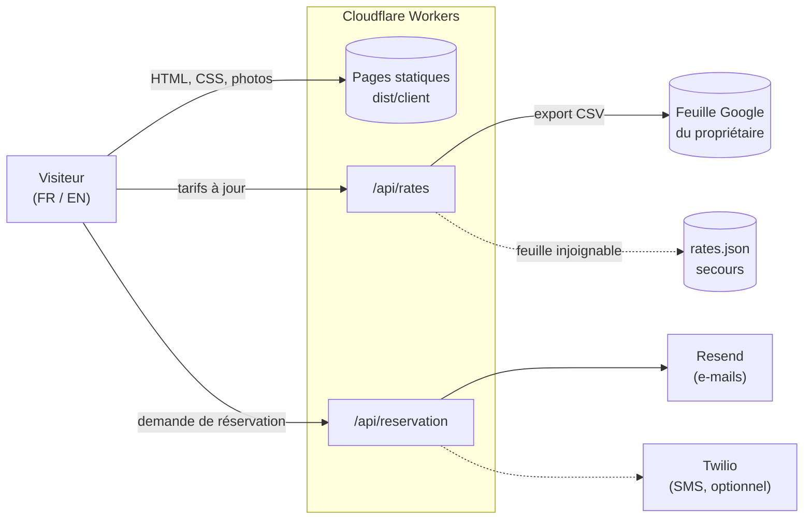

# Villa Les Zines · site de location au Cap Ferret

[](https://github.com/ju150/les-zines/actions/workflows/ci.yml)
[](https://github.com/ju150/les-zines/actions/workflows/surveillance.yml)

**[www.leszines.fr](https://www.leszines.fr)** : le site d'une grande villa en bois du Cap Ferret, louée à la
semaine en été et mise en vente en toute discrétion. Il est en production et sert de vrais
clients : le propriétaire tient les tarifs dans une feuille Google, les visiteurs consultent les
disponibilités en français ou en anglais et envoient leur demande de réservation depuis le site.

| | |
| --- | --- |
| **Stack** | [Astro 7](https://astro.build) (pages statiques), TypeScript strict, Tailwind CSS |
| **Hébergement** | Cloudflare Workers : fichiers statiques et deux routes serveur |
| **Tarifs** | feuille Google du propriétaire, lue par `/api/rates`, avec un fichier de secours |
| **Réservation** | e-mails par [Resend](https://resend.com), SMS Twilio en option, repli `mailto:` |
| **Qualité** | typage (`astro check`), tests Vitest, audit SEO du build, scan de secrets, surveillance horaire |

## Architecture



Tout le site est pré-rendu au build. Seules deux routes tournent dans le Worker, et toute leur
logique vit dans `src/lib/`, en fonctions pures qui reçoivent leur configuration en paramètre :
elles se testent sans réseau et sans Cloudflare. Les routes de `src/pages/api/` se contentent de
lire la requête et les variables d'environnement, puis d'appeler ces fonctions.

## Choix techniques, et pourquoi

**Un tableur plutôt qu'un CMS.** Le propriétaire n'a rien à apprendre : une ligne par semaine
(arrivée, départ, prix, disponibilité). Le site déduit le reste : mois, numéro de semaine, nuits,
zones de vacances scolaires, semaines passées. Le lecteur de la feuille
([`src/lib/rates/sheet.ts`](src/lib/rates/sheet.ts)) accepte les formats de date que Google
renvoie réellement, reconnaît les statuts à leur sens (« loué », « réservé », « complet »…) et
déjoue deux pièges vécus : « indisponible » contient « dispo », et un « non » saisi dans la colonne
Zones ne doit pas masquer la semaine. Chacun de ces cas a son test.

**Jamais de tableau vide.** Les tableaux de disponibilités sont rendus au build à partir de
`src/data/rates.json`, puis rafraîchis dans le navigateur par `/api/rates`. Si la feuille est
injoignable, vide ou illisible, la route sert ce secours et l'indique (`"source": "local"`) ; la
surveillance horaire le signale.

**Une demande de réservation n'est jamais perdue.** La route
([`src/lib/reservation/handler.ts`](src/lib/reservation/handler.ts)) filtre les robots par un
champ pot de miel, nettoie les champs (pas de retour à la ligne dans l'objet d'un e-mail, ce qui
empêcherait d'injecter des en-têtes), échappe tout le HTML, prévient le propriétaire puis envoie
un accusé de réception au visiteur. Sans service d'envoi configuré, le navigateur bascule sur un
e-mail pré-rempli ; l'échec de l'accusé de réception ne fait jamais échouer la demande.

**SEO et visibilité dans les IA.**
- URL canoniques à slash final, partout : un lien sans slash coûterait une redirection 301.
- hreflang `fr`, `en` et `x-default` sans région, identiques dans les pages et dans le sitemap.
- Données structurées JSON-LD : `VacationRental`, `RealEstateListing`, `BreadcrumbList`.
- La semaine choisie voyage dans le fragment (`/reservation/#week=…`), pas dans la query : Google
  ne voit qu'une seule page de réservation au lieu d'une par semaine.
- [`llms.txt`](public/llms.txt) donne aux assistants IA une fiche de faits sans mise en page à
  décoder ; [`robots.txt`](public/robots.txt) accueille les moteurs de recherche et les agents
  déclenchés par la question d'un utilisateur, et refuse les robots d'entraînement, en cohérence
  avec le réglage *AI Crawl Control* de Cloudflare.
- 36 redirections 301 ([`_redirects`](public/_redirects)) conservent les adresses de l'ancien site.

**Aucun secret dans le dépôt.** Clés et adresse de la feuille sont des secrets Cloudflare, lus en
un seul endroit ([`src/lib/env.ts`](src/lib/env.ts)). La CI scanne tout l'historique git à chaque
push. En-têtes de sécurité dans [`_headers`](public/_headers) (HSTS, `X-Frame-Options`, CSP en
mode rapport).

**Une surveillance hébergée ailleurs.** Le 30 août 2026, l'hébergeur précédent a suspendu le
compte et le site est resté hors ligne sans que personne ne soit prévenu. Depuis, un workflow
GitHub Actions ([`surveillance.yml`](.github/workflows/surveillance.yml)), indépendant de
Cloudflare, vérifie chaque heure que les pages répondent, que les tarifs viennent bien de la
feuille, que la route de réservation s'exécute, que l'apex redirige vers `www` et que la
messagerie du domaine (MX, clé DKIM d'envoi) est intacte.

## Qualité

| Commande | Rôle |
| --- | --- |
| `npm run check` | typage TypeScript et Astro |
| `npm test` | tests Vitest : lecture de la feuille, rendu des disponibilités, chargement des tarifs, réservation, traductions |
| `npm run build` | construit le site dans `dist/` |
| `npm run audit:seo` | audite le build : titres et descriptions, canonical, hreflang réciproques, un seul `h1`, JSON-LD valide, liens internes, `alt` des images, sitemap, pages orphelines |
| `npm run verify` | les quatre à la suite, comme la CI |

La [CI](.github/workflows/ci.yml) les exécute à chaque push et à chaque pull request, et
[gitleaks](https://github.com/gitleaks/gitleaks) y scanne tous les commits de l'historique.
Dependabot propose chaque mois une mise à jour groupée des dépendances, validée par la CI.

## Structure

```
src/
  pages/               routes : 9 pages FR, leurs 9 équivalents EN sous /en/, 404
    api/               rates.ts et reservation.ts : seules routes exécutées côté serveur
  components/pages/    contenu de chaque page, une seule source pour les deux langues
  components/          navigation, pied de page, en-têtes, visionneuse, JSON-LD
  layouts/Base.astro   <head> commun : canonical, hreflang, Open Graph
  lib/rates/           feuille → semaines → tableau de disponibilités
  lib/reservation/     champs, e-mails, envoi, traitement d'une demande
  lib/env.ts           seul accès aux variables d'environnement
  i18n/ui.ts           toutes les chaînes FR et EN
  data/                coordonnées, tarifs de secours, schémas JSON-LD
tests/                 tests Vitest de src/lib et de l'i18n
scripts/               audit SEO, manifeste des photos, optimisation des images et des polices
docs/                  guide des tarifs, journal de migration, design system
public/                photos, polices auto-hébergées, robots.txt, llms.txt, _headers, _redirects
```

## Développement local

Prérequis : Node 22 (voir `.nvmrc`).

```bash
npm ci
cp .env.example .env   # facultatif : sans clés, les tarifs viennent de rates.json et le formulaire passe par mailto
npm run dev            # http://localhost:4321 et /en/ pour l'anglais
```

## Déploiement

Chaque push sur `main` est construit et déployé par Cloudflare Workers Builds
(`npm run build`, puis `npx wrangler deploy -c dist/server/wrangler.json`). Les variables non
sensibles sont dans [`wrangler.jsonc`](wrangler.jsonc) ; les secrets sont des variables
d'exécution du Worker (Settings → Variables and Secrets, type « Secret », ou
`npx wrangler secret put <NOM> --name les-zines`), jamais des variables de build. Aucun n'est
lu par `import.meta.env`, que Vite fige au build : le bundle déployé n'en contient aucun.

| Secret | Rôle |
| --- | --- |
| `RATES_SHEET_CSV_URL` | adresse d'export CSV de la feuille des tarifs |
| `RESEND_API_KEY` | envoi des demandes et des accusés de réception |
| `TWILIO_*` | SMS au propriétaire (optionnel, non utilisé aujourd'hui) |

Le détail de la mise en place, DNS compris, est dans le
[journal de migration](docs/runbook-migration-cloudflare.md).

## Documentation

- [Guide des tarifs](docs/guide-tarifs.md) : la feuille Google, colonne par colonne, pour le propriétaire.
- [Journal de migration](docs/runbook-migration-cloudflare.md) : passage de Netlify à Cloudflare Workers.
- [Design system](docs/design-system.md) : couleurs, typographie, composants.
- [AGENTS.md](AGENTS.md) : règles du projet pour les agents de code.

## Méthode

Conçu, développé et maintenu par [Julien Bernard](https://github.com/ju150). Chaque changement est vérifié avant de partir en production (typage, tests,
build, audit SEO), et les messages de commit expliquent le pourquoi autant que le quoi.

## Licence

Code publié à titre de démonstration, sans licence open source : tous droits réservés. Les
photos, les textes et le nom « Villa Les Zines » appartiennent au propriétaire de la villa.
